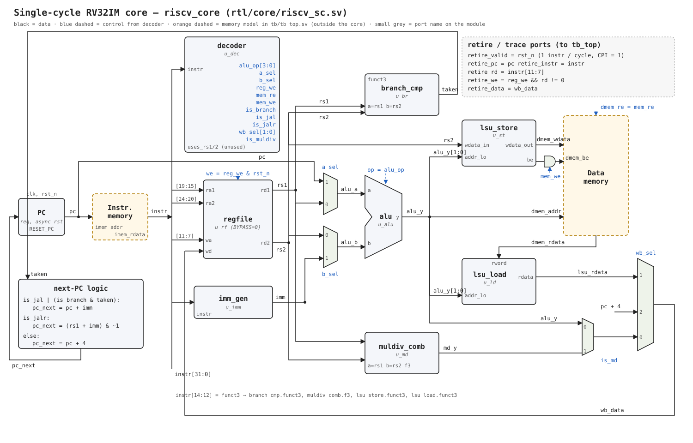

# RV32IM RISC-V Core — Design, Verification and PPA Study

A RISC-V processor written in SystemVerilog, built step by step from a single-cycle core
to a 5-stage pipeline, then used as a platform to measure how micro-architecture choices
(multiplier design, branch prediction) affect performance, area and timing.

## Status

| Stage | Content | Status |
|---|---|---|
| Single-cycle core | RV32IM, CPI = 1 | ✅ 48/48 riscv-tests pass |
| 5-stage pipeline | forwarding, load-use stall, branch flush, multi-cycle mul/div | ⏳ in progress |
| Synthesis & timing | Yosys + SKY130, Cadence Genus | ⬜ |
| Multiplier study | 5 micro-architectures compared | ⬜ |
| Branch prediction | BTB + 2-bit counters | ⬜ |

## Single-cycle core



- ISA: RV32I + M extension (no CSR / interrupts, aligned memory access only)
- Modules (`rtl/core/`):

| File | Function |
|---|---|
| `regfile.sv` | 32 × 32-bit register file, 2 read / 1 write ports, x0 hard-wired to 0 |
| `imm_gen.sv` | immediate extraction for I / S / B / U / J formats |
| `alu.sv` | add, sub, shifts, compares, logic ops |
| `branch_cmp.sv` | branch condition (beq, bne, blt, bge, bltu, bgeu) |
| `lsu.sv` | byte / half-word store lane placement and load sign/zero extension |
| `decoder.sv` | instruction → control signals |
| `muldiv_comb.sv` | combinational M extension, also the golden model for later multipliers |
| `riscv_sc.sv` | single-cycle top level (`riscv_core`) |

## Verification

1. **Unit tests** — a Python reference model generates golden vectors (random + corner cases);
   the SystemVerilog testbench compares every leaf module against them (9380 checks).
2. **riscv-tests** — the official RISC-V instruction tests (rv32ui + rv32um, 48 programs);
   each program checks itself and reports through `tohost`.
3. **Programs** — C and assembly programs run on the core (`sw/c/`, `sw/asm/`).

Results (single-cycle core):

| Test | Result |
|---|---|
| `make unit` | PASS, 9380 checks |
| `make tests CORE=rtl/core/riscv_sc.sv` | 48/48 |
| `make hello CORE=rtl/core/riscv_sc.sv` | PASS, CPI = 1.00 |

## How to run

Requirements: OSS CAD Suite (Verilator, Yosys), xPack `riscv-none-elf-gcc`,
[riscv-tests](https://github.com/riscv-software-src/riscv-tests) cloned to `$RISCV_TESTS`.

```bash
make unit                               # leaf-module unit tests
make tests CORE=rtl/core/riscv_sc.sv    # riscv-tests on the single-cycle core
make hello CORE=rtl/core/riscv_sc.sv    # run sw/c/hello.c
```

## Repository layout

```
rtl/core/   RTL
tb/         testbenches
sw/         riscv-tests environment, C runtime, programs
scripts/    vector generation, test runners, trace tools
docs/       diagrams and notes
```

The verification infrastructure (`tb/`, `scripts/`, `sw/env/`) is based on a guided starter kit.
