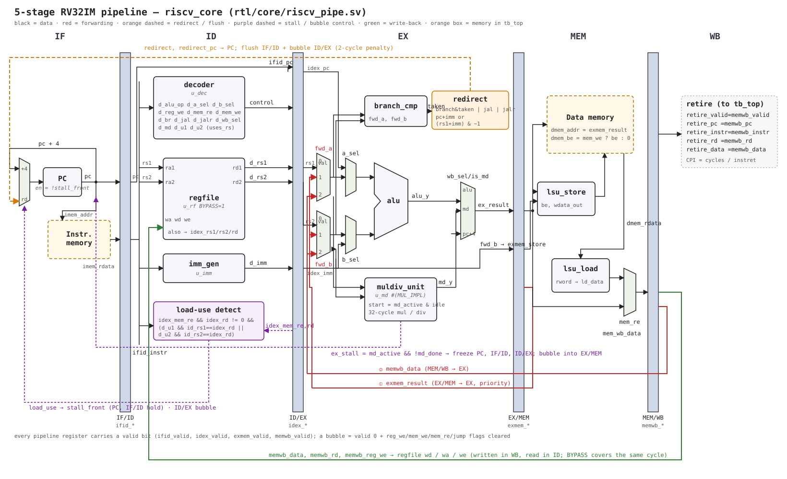

# RV32IM RISC-V Core — Design, Verification and PPA Study

A RISC-V processor written in SystemVerilog, built step by step from a single-cycle core
to a 5-stage pipeline, then used as a platform to measure how micro-architecture choices
(multiplier design, branch prediction) affect performance, area and timing.

## Status

| Stage | Content | Status |
|---|---|---|
| Single-cycle core | RV32IM, CPI = 1 | ✅ 48/48 riscv-tests |
| 5-stage pipeline | forwarding, load-use stall, branch flush, iterative mul/div | ✅ 48/48, random differential tests, 9 mutants |
| Synthesis & timing | Yosys + SKY130, Cadence Genus | ⬜ |
| Multiplier study | 5 micro-architectures compared | ⬜ |
| Branch prediction | BTB + 2-bit counters | ⬜ |

## 5-stage pipeline



- **IF → ID → EX → MEM → WB**, one valid bit per pipeline register; a bubble clears every side effect
  (register write, memory access, jump, forwarding).
- **Forwarding** EX/MEM → EX (priority) and MEM/WB → EX, never from x0; the register file bypasses
  WB → ID in the same cycle.
- **Load-use hazard**: 1-cycle stall detected in ID (uses `uses_rs1/uses_rs2`, so LUI/JAL never stall).
- **Control hazards**: predict-not-taken, branches and jumps resolved in EX, 2-cycle penalty;
  redirect has priority over stall.
- **M extension**: iterative radix-2 multiplier and restoring divider (32 cycles) behind a
  start/done handshake; operands are latched at start; the front end freezes while EX waits.

### CPI baseline (C benchmarks, predict-not-taken, iterative multiplier)

| Benchmark | Instructions | Cycles | CPI | Main source of extra cycles |
|---|---|---|---|---|
| matmul | 38866 | 202444 | 5.21 | multiplications (33 cycles each) |
| sort | 62288 | 92593 | 1.49 | load-use stalls + taken branches |
| crc32 | 36035 | 46241 | 1.28 | taken branches |
| fib | 81677 | 105105 | 1.29 | calls / returns (jal, jalr) |

The CPI estimate `1 + (2·taken + load_use + 33·mul + 33·div) / instructions` from
`scripts/profile.py` matches the simulated CPI, so every stall cycle is accounted for.

## Verification

1. **Unit tests** — a Python reference model generates golden vectors (random + corner cases);
   every leaf module is compared against them (9380 checks). The mul/div unit is compared with
   the combinational reference on 2912 operations.
2. **riscv-tests** — the official RISC-V instruction tests (rv32ui + rv32um, 48 programs): 48/48.
3. **Random differential testing** — hazard-heavy random programs run on the single-cycle core
   (reference) and on the pipeline; the commit logs are compared instruction by instruction.
4. **Mutation testing** — 9 deliberate bugs injected into the pipeline to measure how strong the
   tests are. Details: [docs/verification.md](docs/verification.md).

| Injected bug | riscv-tests pass | random pass (10) |
|---|---|---|
| no load-use stall | 42/48 | 0/10 |
| jalr redirects but does not flush | **47/48** | 0/10 |
| forwarding ignores rd = x0 | **48/48** | 1/10 |
| store data not forwarded | 43/48 | 5/10 |

The two suites complement each other: some serious bugs slip through riscv-tests and are
caught only by the random tests.

## Single-cycle core


| File | Function |
|---|---|
| `regfile.sv` | 32 × 32-bit register file, 2 read / 1 write ports, x0 hard-wired to 0, optional bypass |
| `imm_gen.sv` | immediate extraction for I / S / B / U / J formats |
| `alu.sv` | add, sub, shifts, compares, logic ops |
| `branch_cmp.sv` | branch condition (beq, bne, blt, bge, bltu, bgeu) |
| `lsu.sv` | byte / half-word store lane placement and load sign/zero extension |
| `decoder.sv` | instruction → control signals |
| `muldiv_comb.sv` | combinational M extension, golden model for the multipliers |
| `riscv_sc.sv` | single-cycle top level, used as the reference core |

## How to run

Requirements: OSS CAD Suite (Verilator, Yosys), xPack `riscv-none-elf-gcc`,
[riscv-tests](https://github.com/riscv-software-src/riscv-tests) cloned to `$RISCV_TESTS`.

```bash
make unit                               # leaf-module unit tests
make muldiv MUL_IMPL=1                  # mul/div unit vs. combinational reference
make tests                              # riscv-tests on the pipeline
make tests CORE=rtl/core/riscv_sc.sv    # riscv-tests on the single-cycle core
make random N=100                       # pipeline vs. single-cycle, random programs
make bench                              # C benchmarks: cycles / CPI
```

## Repository layout

```
rtl/core/   RTL (module list and status: rtl/core/README.md)
tb/         testbenches
sw/         riscv-tests environment, C runtime, benchmarks, assembly programs
scripts/    vector generation, test runners, random generator, trace comparison, profiler
docs/       diagrams, verification report
```

The verification infrastructure (`tb/`, `scripts/`, `sw/env/`) is based on a guided starter kit.
